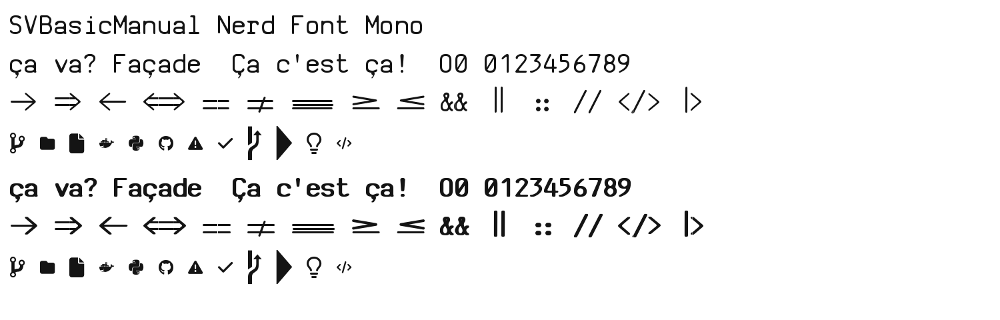

# SVBasicManual Nerd Font Mono

A patched version of **SV Basic Manual**, a fixed-width font designed by [Johan Winge](http://home.student.uu.se/jowi4905/) (2004), with missing glyphs added, explicit monospace metadata, and a full [Nerd Fonts](https://www.nerdfonts.com/) icon set.



## What's changed from the original

- **Added `ç` / `Ç` glyphs.** The original font had `c`, `C`, and `,` but no cedilla and no precomposed ç/Ç. These were synthesized by merging the `c`/`C` outlines with a scaled-down, repositioned copy of the `comma` outline, then mapped to U+00E7 and U+00C7 in the cmap.
- **Slashed zero.** `0` was identical to `O` (same outline, same bounds); added a diagonal slash to the zero in both weights, trimmed to the glyph's outer shape and merged into a single clean outline.
- **Programming ligatures (`calt`).** 29 contextual sequences, each drawn as one wide outline and split into one piece per cell so the monospace grid is never broken: `->` `-->` `<-` `<--` `<->` `=>` `==>` `<==` `<=>` `==` `===` `!=` `!==` `>=` `<=` `--` `---`, plus "tightened" pairs `::` `//` `||` `&&` `++` `>>` `<<` `<>` `</` `/>` `|>` `<|`. Most terminals need ligatures switched on (iTerm2: Profiles → Text → *Use ligatures*).
- **Repaired bold `<` and `>`.** The original Bold font shipped with corrupted outlines for these two glyphs (stray coordinates thousands of units off-canvas); `>` had one bad control point and `<` was rebuilt as its mirror image.
- **Declared as monospace.** The font was already visually fixed-width (160 of 163 glyphs shared one advance width), but didn't say so in its metadata. Set `post.isFixedPitch` and the PANOSE `bProportion` field to monospace, and set `OS/2.xAvgCharWidth` accordingly.
- **Patched into a Nerd Font.** Ran the official [`ryanoasis/nerd-fonts`](https://github.com/ryanoasis/nerd-fonts) `font-patcher` (v3.5.1) in `--complete --mono` mode, adding ~11,000 icon glyphs: Powerline, Powerline Extra, Font Awesome (+ Extension + Brands), Devicons, Material Design Icons, Octicons, Codicons, Weather Icons, Pomicons, Font Logos, IEC Power Symbols, and Braille — all sized to fit the font's fixed-width cell so terminal alignment isn't broken.
- **Packaged as a single file.** Regular and Bold are bundled together as one TrueType Collection (`.ttc`), sharing common tables, the same way many system font bundles work.

## Installation

**macOS**
```sh
cp SVBasicManualNerdFontMono.ttc ~/Library/Fonts/
```

Then select **SVBasicManual Nerd Font Mono** (Regular/Bold) in your terminal's profile settings.

**Linux**
```sh
mkdir -p ~/.local/share/fonts
cp SVBasicManualNerdFontMono.ttc ~/.local/share/fonts/
fc-cache -f
```

## License

The original *SV Basic Manual* font is © 2004 Johan Winge. No explicit license file or terms are embedded in the font or were found at its original distribution point; it has circulated on font-aggregator sites as "free for personal and commercial use," but that claim is unverified and no redistribution/modification rights are confirmed.

**This repo is not an official Nerd Fonts distribution** and is not affiliated with the `ryanoasis/nerd-fonts` project. The Nerd Fonts patcher and bundled icon sets are used here under their own respective licenses (see [license-audit.md](https://github.com/ryanoasis/nerd-fonts/blob/master/license-audit.md) in the nerd-fonts repo).

If you are Johan Winge, or know how to reach him, please get in touch — proper licensing clarity for the base font would be very welcome.

## Credits

- Base font: Johan Winge, *SV Basic Manual* (2004)
- Icon glyphs & patcher: [Nerd Fonts](https://www.nerdfonts.com/) / [ryanoasis/nerd-fonts](https://github.com/ryanoasis/nerd-fonts)
